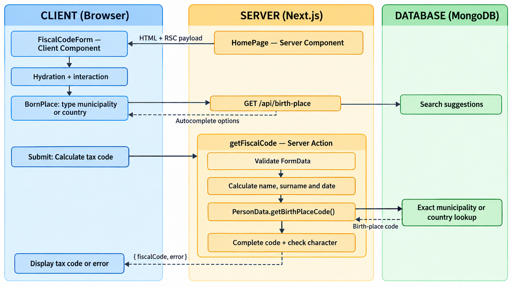

# MyFiscalCode

The aim of this project is to provide an online Italian tax code calculator that is free from cookies and/or trackers.
The calculation of the tax code for an Italian individual is based on the provisions set out in the law [DPR n. 605 del 29 settembre 1973](https://www.gazzettaufficiale.it/atto/vediMenuHTML?atto.codiceRedazionale=073U0605&atto.dataPubblicazioneGazzetta=1973-10-16&tipoSerie=serie_generale&tipoVigenza=originario).

## Architecture blueprint

The Home page (`app/page.tsx`) is a Server Component because it does not use
the `"use client"` directive. Next.js renders or pre-renders the initial route
on the server and sends its HTML and React Server Component payload to the
browser. `FiscalCodeForm` is a Client Component nested inside that page, so its
JavaScript is loaded in the browser and hydrates the interactive form.

The database is read at two different points in the user flow:

1. While the user types a birth place, the client-side `BornPlace` component
   calls `GET /api/birth-place`. The Route Handler queries MongoDB for matching
   municipalities or foreign States and returns up to ten autocomplete options.
   Each option contains its label and cadastral or State code.
2. When the user submits the form, `FiscalCodeForm` invokes the
   `getFiscalCode` Server Action through `useActionState`. The action treats the
   submitted `FormData` as untrusted input, validates it, creates a `PersonData`
   instance, and calculates the surname, name, and birth-date portions.
3. `PersonData.getBirthPlaceCode()` performs a second, exact MongoDB lookup by
   municipality or State name. The calculation deliberately resolves the code
   again on the server instead of trusting a code received from the browser.
4. After retrieving the birth-place code, the action completes the partial tax
   code, calculates its control character, and returns
   `{ fiscalCode, error }` to the Client Component. The client then displays
   either the calculated tax code or an error message. No submitted personal
   data is persisted in MongoDB.

An autocomplete database failure clears the available suggestions and prevents
the form from becoming valid. If the exact lookup fails after a place has been
selected, or no matching record exists, the Server Action returns the generic
calculation error to the client.



### Technology stack

| Technology                                                                             | Version |
| -------------------------------------------------------------------------------------- | ------- |
| [Node.js](https://nodejs.org/)                                                         | v24     |
| [Next.js](https://nextjs.org/)                                                         | v16.3.2 |
| [React](https://react.dev/)                                                            | v19.2.8 |
| [Material UI](https://mui.com/material-ui/)                                            | v7.3.11 |
| [MUI for Next.js](https://mui.com/material-ui/integrations/nextjs/)                    | v7.3.10 |
| [MUI X Date Pickers](https://mui.com/x/react-date-pickers/)                            | v8.29.5 |
| [Tailwind CSS](https://tailwindcss.com/)                                               | v4.3.3  |
| [TypeScript](https://www.typescriptlang.org/)                                          | v5.9.3  |
| [MongoDB](https://www.mongodb.com/)                                                    | v9      |
| [Mongoose](https://mongoosejs.com/)                                                    | v9.11.2 |
| [Moment.js](https://momentjs.com/)                                                     | v2.31.0 |
| [Jest](https://jestjs.io/)                                                             | v30.5.2 |
| [React Testing Library](https://testing-library.com/docs/react-testing-library/intro/) | v16.3.3 |
| [Playwright](https://playwright.dev/)                                                  | v1.64.1 |

## Configure your .env

Stating from `example.env` you can create his own `.env`.

## Local deploy with Docker

For the build and run of this app with MongoDB you have to run:

```bash
docker compose up -d
```

The app will be available on [http://localhost:3000](http://localhost:3000)
During the startup the service `mongo-seed` will create the db `myfiscalcode` and will import the italian city names with their codes and the States with their code. The list of city names and States with their codes is available in `app/resources`.

To stop the service and delete the db you have to run:

```bash
docker compose down --volumes
```

## Start in development mode

Use the correct version of node with:

```bash
nvm use
```

Install dependencies:

```bash
npm i
```

Run the development server:

```bash
npm run dev
```

Open [http://localhost:3000](http://localhost:3000) with your browser to see the result.

## End-to-end tests

The Playwright tests use a dedicated MongoDB database. Start MongoDB locally,
then configure and seed a database whose name ends in `-e2e`:

```bash
export MONGODB_URI="mongodb://127.0.0.1:27017/myfiscalcode-e2e"
export MONGODB_DB_NAME="myfiscalcode-e2e"
npm run test:e2e:seed
npm run test:e2e
```

Use `npm run test:e2e:ui` to inspect and debug the scenarios interactively.
The GitHub Actions workflow starts and seeds its own MongoDB service.

You can start editing the page by modifying `app/page.tsx`. The page auto-updates as you edit the file.

This project uses [`next/font`](https://nextjs.org/docs/app/building-your-application/optimizing/fonts) to automatically optimize and load [Geist](https://vercel.com/font), a new font family for Vercel.

## Deploy on Vercel

The easiest way to deploy your Next.js app is to use the [Vercel Platform](https://vercel.com/new?utm_medium=default-template&filter=next.js&utm_source=create-next-app&utm_campaign=create-next-app-readme) from the creators of Next.js.

Check out our [Next.js deployment documentation](https://nextjs.org/docs/app/building-your-application/deploying) for more details.
